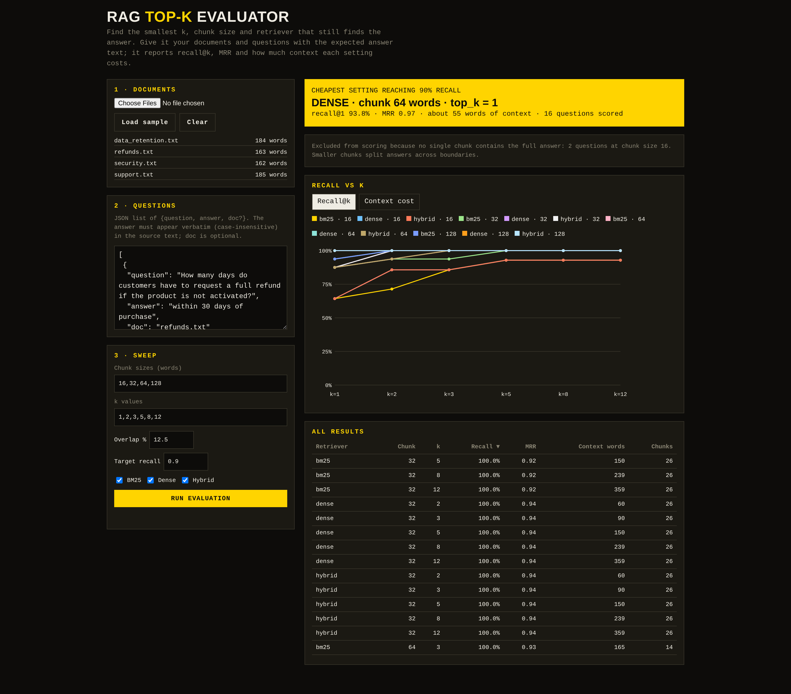

# RAG Top-K Evaluator

## Live demo

Live: https://YOUR-APP.onrender.com

## Screenshots



Answers one question: **what is the smallest `top_k` (and the best chunk size and retriever) that still finds the answer in my documents?**

It chunks your documents, runs BM25, dense and hybrid (reciprocal rank fusion) retrieval, and reports for every chunk size x retriever x k:

- **recall@k**: share of questions whose answer-bearing chunk is in the top k
- **MRR**: how high the first correct chunk ranks
- **context cost**: roughly k x average chunk words, a proxy for prompt tokens

It then recommends the cheapest setting that reaches your target recall (default 90%). Questions whose answer is split across a chunk boundary (no single chunk contains it) are **unanswerable** at that chunk size. They count as misses: `recall` and `mrr` are computed over *all* questions, so a tiny chunk size cannot look good by quietly dropping the questions it cannot answer. The old number is kept as `recall_answerable` (hits over answerable questions only), and the UI table shows both plus a warning badge where more than 10% of questions are unanswerable.

## How it works

1. **Chunking**: each document is split into fixed-size word windows (default 16/32/64/128 words) with 12.5% overlap.
2. **Retrievers**: *BM25* (own implementation, k1=1.5, b=0.75) scores lexical matches; *dense* embeds chunks and the question (TF-IDF + SVD offline, or sentence-transformers) and ranks by cosine similarity; *hybrid* fuses both rankings with reciprocal rank fusion, score = sum of 1/(60 + rank).
3. **Metrics**: each retriever runs once per question for the largest k; *recall@k* is the share of questions whose answer text appears in one of the top k chunks, *MRR* is the mean reciprocal rank of the first correct chunk.
4. **Recommendation**: the setting with the fewest context words (k x average chunk size) that reaches the target recall. If none does, the best-recall setting is returned with `met_target: false`.

## Deploy

1. Push this repo to GitHub.
2. On [Render](https://render.com): **New -> Blueprint**, pick the repo. It reads `render.yaml` (free web service, health check at `/health`).
3. The `Dockerfile` also works for Hugging Face Spaces (Docker SDK; set the exposed port to 8000), Railway and Fly (`fly launch`). The container listens on `$PORT`, default 8000.

Free hosts sleep when idle, so the first request after a pause is slow.

## Limits of the hosted app

To keep a small free host responsive:

- Uploads: at most **10 files** per request and **5 MB** per file (HTTP 413).
- Total document text: 2,000,000 characters (HTTP 413).
- At most **200 questions**, 10 chunk sizes and 10 k values per evaluation (HTTP 422).

## Optional extras

The base install is light on purpose (`requirements.txt`). Install these only if you want them:

- `sentence-transformers`: real embeddings (`RAG_EMBEDDER=sentence-transformers`) and the cross-encoder reranker. Heavy (pulls in PyTorch), so it is not in `requirements.txt`; without it a lexical reranker is used.
- `httpx`: needed only for LLM question generation (`QA_PROVIDER`, see Extras). Without it, or without a reachable provider, "Generate questions" produces simple blanked-sentence questions.
- **Ollama on a live server**: Ollama question writing needs an Ollama instance on the same machine, which a free host does not have. `GET /api/capabilities` reports this and the UI shows a note; the evaluator does not depend on it.

## Run

```bash
pip install -r requirements.txt
uvicorn app.main:app --reload      # open http://localhost:8000 and click "Load sample"
python -m app.cli --docs data/docs --qa data/qa.json   # same thing in the terminal
pip install -r requirements-dev.txt && pytest
```

## Extras

- **Generate questions** (`POST /api/generate-qa`): samples sentences from your documents. By default the answer is a distinctive span (a number, else the rarest words) and the question is the sentence with that span blanked, which is lexically easy and flatters BM25. Set `QA_PROVIDER` to have an LLM write a natural question *and* choose the answer span (see below). Review generated questions before trusting the numbers.

  | `QA_PROVIDER` | Needs | Model env var (default) |
  |---|---|---|
  | `anthropic` | `ANTHROPIC_API_KEY` | `RAG_QA_MODEL` (`claude-haiku-4-5-20251001`) |
  | `gemini` | `GEMINI_API_KEY` | `GEMINI_MODEL` (`gemini-2.0-flash`) |
  | `groq` | `GROQ_API_KEY` | `GROQ_MODEL` (`llama-3.3-70b-versatile`) |
  | `ollama` | local Ollama at `http://localhost:11434` | `OLLAMA_MODEL` (`llama3.2`) |

  Unset, it falls back to the heuristic (if only `ANTHROPIC_API_KEY` is set, `anthropic` is used). Providers are called with plain `httpx`, one request per generate. Any answer that is not a verbatim substring of its source sentence is discarded and that sentence gets the heuristic pair; any provider error falls back for the whole batch. The response reports `method`, `llm_used` and `heuristic_used`.
- **Reranker** (tick "Also compare with a reranker"): each retriever's top 20 are re-ordered before the top-k cut, and both variants appear in the table and chart (`+rerank`). Uses the `cross-encoder/ms-marco-MiniLM-L-6-v2` cross-encoder when sentence-transformers is installed (override with `RAG_RERANKER`), otherwise a small lexical reranker so the comparison still runs offline. The response names which one ran.
- **Download**: results table as CSV, recommendation (plus unanswerable and position check) as Markdown. Both are built in the browser.
- **Lost in the middle**: for the recommended top_k, shows how many correct chunks land in the middle third of the retrieved list. Needs k of at least 3; with the best setting often at k=1 or 2 it will say there is no middle. Rerun with a larger target or a fixed larger `ks` to inspect it.

## Your own data

Upload `.txt`, `.md` or `.pdf` files. Questions are a JSON list:

```json
[{"question": "How often do API keys rotate?", "answer": "every 90 days", "doc": "security.txt"}]
```

`answer` must appear verbatim (case-insensitive) in the source text. `doc` is optional and restricts which document counts as correct.

## Real embeddings

The default "dense" retriever is TF-IDF + SVD, so everything runs offline with no downloads. For a real embedding model:

```bash
pip install sentence-transformers
RAG_EMBEDDER=sentence-transformers uvicorn app.main:app
```

## Limits

- "Tokens" are whitespace-separated words, not model tokens.
- The sample set is tiny (4 documents, 16 questions), so use your own corpus before trusting a recommendation.
- Reranker and lost-in-the-middle results are computed on the same small question set, so differences of a few points are noise.
- Correctness is substring-based: a chunk is right if it contains the expected answer text.

## Layout

```
app/chunking.py     fixed-size chunks with overlap
app/retrievers.py   BM25, dense (SVD or sentence-transformers), hybrid RRF
app/evaluate.py     sweep and recommendation
app/rerank.py       cross-encoder or lexical reranker
app/qagen.py        question generation
app/loaders.py      .txt/.md/.pdf text extraction
app/cli.py          terminal results table
app/main.py         FastAPI API + static UI     static/index.html  the UI
```
